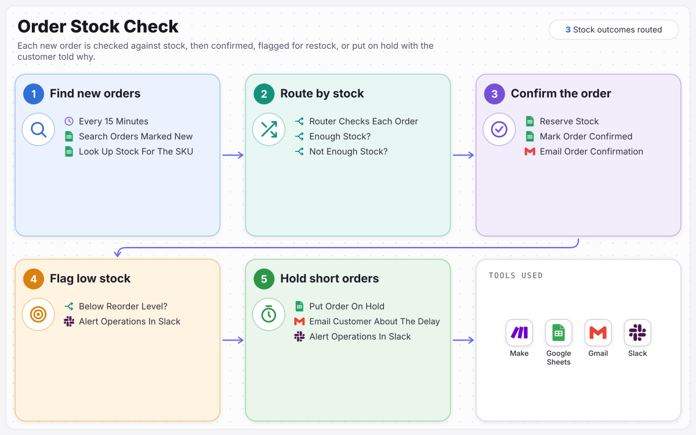

# Order Stock Check

No order is confirmed without the stock to fill it.

> Built for **Juniper & Moss**, a fictional sample client. The business, people and data are invented; the scenario is complete and runs.

Every new order is checked against the inventory sheet: confirmed and reserved when there is stock, flagged in Slack when stock runs low, and put on hold with the customer told why when there is not enough.

**Full case study:** [ramonvallejera.com/case-study/order-stock-check](https://ramonvallejera.com/case-study/order-stock-check)

## How it works

1. Find new orders every 15 minutes
2. Look up the stock for each SKU
3. Route by stock
4. Enough stock: reserve it, confirm the order, email the customer
5. Below the reorder level: alert operations in Slack
6. Not enough stock: put the order on hold, email the customer, alert operations

Built a Make scenario that checks the order sheet every 15 minutes for new orders and looks up each product in the inventory sheet. A Router sends every order down the right path: confirm it, reserve the stock and email the customer; alert operations in Slack when stock falls below its reorder level; or put the order on hold, email the customer about the delay and alert operations.

## What's in this repo

| File | What it is |
|---|---|
| `blueprint.json` | The Make scenario, 10 modules with a three-route Router, ready to import |
| `docs/process-map.svg` | The process map from the case study |

Trigger: `Search Rows` in Google Sheets, finding orders whose status is `New`, up to 10 per run.

## Set it up

1. In Make, create a scenario, open the **⋯** menu, choose **Import Blueprint** and select `blueprint.json`.
2. Connect these accounts on the modules that need them:

   - Google Sheets (5 modules)
   - Gmail (Google) (2 modules)
   - Slack (2 modules)

3. Replace the placeholders with your own:

   - `YOUR_ORDERS_SHEET_ID` (3×): the order sheet, with the status in column G
   - `YOUR_INVENTORY_SHEET_ID` (2×): the inventory sheet, with SKU, product, stock and reorder level
   - `YOUR_SLACK_CHANNEL_ID` (1×): the operations channel for low-stock alerts (on-hold alerts post to `#operations`)

4. Add a test order marked `New`, click **Run once**, then schedule the scenario every 15 minutes.

Tools: Make, Google Sheets, Gmail, Slack.

## Notes

- Connections and account IDs were removed before publishing. Make asks for a connection on each module after import.
- Built by Ramon Vallejera Jr., AI Automation Specialist.
